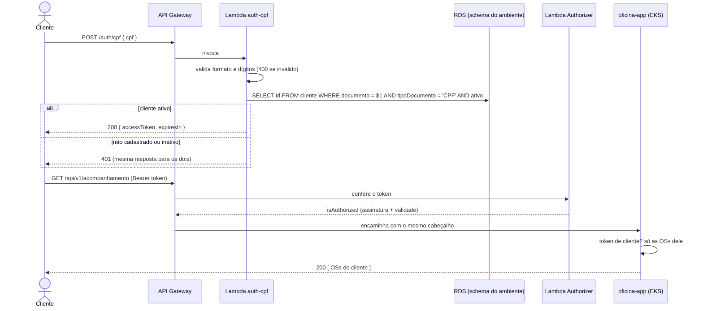

# oficina-lambda-auth

Funções serverless da Oficina (AWS SAM, TypeScript): o **API Gateway** de entrada, a Lambda
**`auth-cpf`** (CPF → JWT do cliente) e a **Lambda Authorizer** que confere o JWT antes de encaminhar
a requisição para a API.

## Tecnologias

- **AWS**: API Gateway (HTTP API), Lambda (Node.js 22), CloudFormation (via SAM), CloudWatch Logs
- **AWS SAM** para descrever, empacotar (esbuild) e implantar as funções
- **TypeScript**, `jsonwebtoken` (HS256), `pg` (Postgres), **Jest**
- **GitHub Actions** para CI/CD

## Arquitetura

```
Cliente / Gestor ──► API Gateway (HTTP API) ── uma stack por ambiente
   │
   ├─ POST /auth/cpf ─────────────────► Lambda auth-cpf ──► RDS (usuário oficina_auth, só SELECT)
   │                                        └─ devolve { accessToken, expiresIn }
   ├─ POST /api/v1/auth/login  ┐
   ├─ GET  /api/v1/health/*    ├─ livres ──────────────────► Load Balancer do oficina-app (EKS)
   ├─ GET  /api/docs*          ┘
   └─ ANY  /api/v1/*  ──► Lambda Authorizer ── token ok? ──► Load Balancer do oficina-app (EKS)
                             sem token → 401 · token inválido → 403
```



### O token

| Campo | Valor |
|---|---|
| `sub` | id do cliente no oficina-app |
| `papel` | `CLIENTE` |
| Algoritmo | HS256, assinado com o mesmo `JWT_SECRET` do oficina-app |
| Validade | 1 hora (`JwtExpiraEmSegundos`) |

O Authorizer aceita os dois tipos de token: o do gestor (`POST /api/v1/auth/login`) e o do
cliente. Ele só responde se o token é legítimo; **qual rota cada um pode usar é decisão do
oficina-app** (token de cliente em rota administrativa → 403, e o cliente só vê as próprias OSs).

### Decisões

- **HTTP API, e não REST API**: mais barato, mais simples e com Lambda Authorizer de resposta
  simples (`isAuthorized: true/false`).
- **Uma stack por ambiente** (`oficina-auth-homolog`, `oficina-auth-prod`): cada Gateway aponta
  para o Load Balancer do namespace do ambiente, e a Lambda lê o schema do mesmo nome no RDS.
- **`auth-cpf` dentro da VPC**: o RDS não tem IP público. Ela usa o security group
  `oficina-lambdas`, criado no repo `oficina-infra-db`, que só libera a saída para a porta 5432
  do banco.
- **Usuário somente-leitura** `oficina_auth`, com `SELECT` só em `cliente`: se a função tiver uma
  falha, não consegue alterar nem apagar dados. O pipeline o cria com um Job no cluster
  ([`k8s/usuario-leitura.yaml`](k8s/usuario-leitura.yaml)), porque o runner do GitHub não alcança
  o banco.
- **"Não cadastrado" e "inativo" respondem igual (401)**: a rota não serve para descobrir quais
  CPFs são clientes.
- **`LabRole`** nas funções: o Learner Lab não deixa criar roles do IAM, que é o que o SAM faria
  por padrão.
- **Segredos como variáveis de ambiente da Lambda**, recebidos como parâmetros `NoEcho`. O
  caminho de produção seria o Secrets Manager, mas a Lambda na VPC sem NAT Gateway não o alcança
  sem um VPC endpoint, que cobra por hora.
- **Logs em JSON**, com o `requestId` do Gateway, em grupos de log da própria stack (7 dias). O
  mesmo id segue para o app no cabeçalho `x-request-id`: o oficina-app o grava nos logs e no New
  Relic, então uma chamada pode ser seguida do Gateway até o banco.

## Estrutura

```
src/
├── auth-cpf/
│   ├── handler.ts      valida o CPF, consulta o cliente, devolve o token
│   └── clientes.ts     consulta no Postgres (search_path = schema do ambiente)
├── authorizer/
│   └── handler.ts      confere assinatura e validade do JWT
└── compartilhado/      cpf.ts · jwt.ts · http.ts (envelope de erro do app) · log.ts
k8s/usuario-leitura.yaml  Job que cria o usuário oficina_auth
template.yaml             Gateway, rotas, Authorizer e Lambdas (SAM)
```

## Pipeline (CI/CD)

| Evento | O que roda |
|---|---|
| PR para `homolog` ou `main` | `tsc`, testes com cobertura (mínimo 80%), `sam validate --lint`, `sam build` — check **Build e testes** |
| Push em `homolog` | Tudo acima + usuário somente-leitura + `sam deploy` da stack `oficina-auth-homolog` + smoke test |
| Push em `main` | O mesmo, na stack `oficina-auth-prod` |
| Manual (Run workflow, digitar `destruir`) | `sam delete` das duas stacks |

O deploy descobre tudo na AWS pelos nomes combinados: `LabRole`, RDS `oficina-db`, security
group `oficina-lambdas`, subnets da VPC do banco e o Load Balancer do Service `oficina-api` no
namespace do ambiente.

O **smoke test** confere pelo Gateway: health público (200), o `requestId` do Gateway devolvido
pelo app no `x-request-id`, rota protegida sem token (401), token
inválido (403), CPF inválido (400), CPF sem cadastro (401), gestor na rota protegida (200) e o
fluxo do cliente: cria o cliente de demonstração (CPF `529.982.247-25`), entra pelo CPF, lista as
OSs dele (200) e é barrado numa rota de gestor (403).

### Configuração do repositório (uma vez)

**Settings → Secrets and variables → Actions**:

| Nome | Tipo | Valor |
|---|---|---|
| `AWS_ACCESS_KEY_ID`, `AWS_SECRET_ACCESS_KEY`, `AWS_SESSION_TOKEN` | Secret | Sessão do Learner Lab (mudam a cada sessão) |
| `DB_PASSWORD` | Secret | Senha do administrador do RDS (a mesma do `oficina-infra-db`); usada só para criar o `oficina_auth` |
| `DB_PASSWORD_LEITURA` | Secret | Senha nova do `oficina_auth`. Gere com `openssl rand -hex 24` (só letras e números) |
| `JWT_SECRET` | Secret | O mesmo do `oficina-app` |
| `TF_STATE_BUCKET` | Variable | Bucket do state do Terraform; o SAM guarda o pacote em `sam/<ambiente>/` |

## Como rodar localmente

```bash
npm ci
npm test                 # 43 testes, sem banco nem AWS
npm run test:cov         # com cobertura

# Build igual ao do pipeline (o esbuild do projeto precisa estar no PATH)
PATH="$PWD/node_modules/.bin:$PATH" sam build
sam validate --lint --region us-east-1
```

Para testar na AWS, o caminho é o pipeline (push em `homolog`). Depois do deploy:

```bash
URL=https://<id>.execute-api.us-east-1.amazonaws.com   # aparece no resumo da execução

curl -s -X POST $URL/auth/cpf -H 'Content-Type: application/json' \
  -d '{"cpf":"529.982.247-25"}'                          # { accessToken, expiresIn }

curl -s $URL/api/v1/acompanhamento -H "Authorization: Bearer <accessToken>"
curl -s -o /dev/null -w '%{http_code}\n' $URL/api/v1/clientes   # 401, barrado no Gateway
```

## Derrubar

Este repositório é o **primeiro** a cair: ④ → ③ → ② → ①.

1. Actions → **SAM** → Run workflow → `destruir`.
2. Depois, os namespaces do oficina-app (`kubectl delete namespace homolog prod`), o
   `oficina-infra-db` e o `oficina-infra-k8s`.

> A `auth-cpf` roda na VPC, e a AWS leva alguns minutos para soltar as interfaces de rede dela
> depois que a função é apagada. Se o destroy do `oficina-infra-db` falhar apagando o security
> group `oficina-lambdas` (`DependencyViolation`), espere uns 10 minutos e rode de novo.

## Custo

Lambda, API Gateway HTTP e CloudWatch Logs cobram por uso: com o volume de testes do projeto, fica
em centavos. Nenhum recurso daqui cobra por hora.

## Onde este repositório se encaixa

A Fase 3 é dividida em 4 repositórios, que se conversam por nomes na AWS, pelo state do Terraform
no S3 e por secrets do GitHub (nenhum importa código de outro):

| # | Repositório | O que cria |
|---|---|---|
| ① | [`oficina-infra-k8s`](https://github.com/madurubini/oficina-infra-k8s) | VPC, subnets, cluster EKS, nós e ECR |
| ② | [`oficina-infra-db`](https://github.com/madurubini/oficina-infra-db) | RDS Postgres dentro da VPC do ① |
| ③ | [`oficina-app`](https://github.com/madurubini/oficina-app) | API NestJS no EKS + Load Balancer |
| ④ | [`oficina-lambda-auth`](https://github.com/madurubini/oficina-lambda-auth) | API Gateway, Lambda `auth-cpf` e Lambda Authorizer |

**Ordem para subir:** ① → ② → ③ → ④. **Ordem para derrubar:** ④ → ③ → ② → ①.

Branches: **`main` = produção** (só recebe PR), **`homolog` = homologação**.
